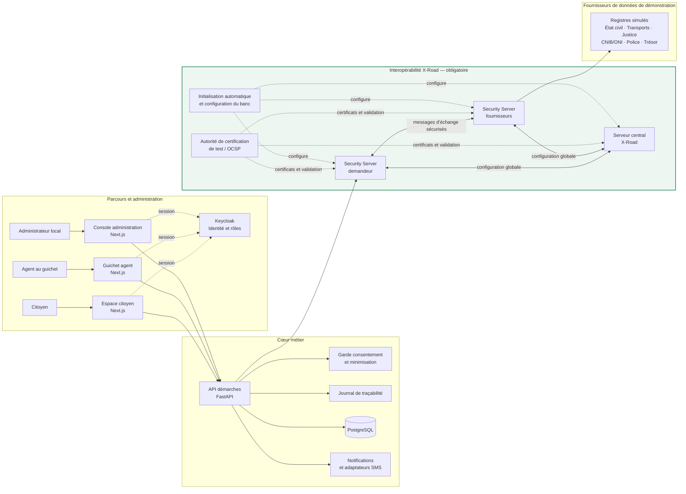
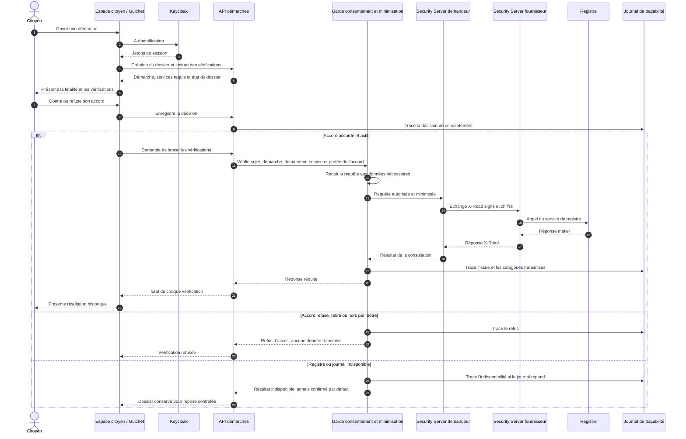

# Dites-le-nous une fois

Plateforme de démarches administratives numériques conçue pour le Hackathon des universités 2026. Elle réunit un espace citoyen, un guichet agent, une administration locale et des services d’interopérabilité reposant sur **X-Road**.

Le dépôt fournit une plateforme de démonstration complète, démarrable avec Docker Compose. Le banc X-Road est inclus dans le démarrage standard. Keycloak gère l’identité, PostgreSQL la persistance, et des registres simulés rendent les parcours interadministrations démontrables de bout en bout.

| Repère | Valeur |
| --- | --- |
| Projet | Dites-le-nous une fois |
| Contexte | Hackathon des universités 2026 |
| Interopérabilité | X-Road, obligatoire dans la pile locale |
| Démarrage | `docker compose up -d --build` |
| Parcours couvert | De la demande citoyenne à la réponse du registre via X-Road |
| Données du banc | Données fictives pour les démonstrations |

## Sommaire

- [Objectifs](#objectifs)
- [Fonctionnalités](#fonctionnalités)
- [Architecture](#architecture)
- [Parcours d’un échange X-Road](#parcours-dun-échange-x-road)
- [Technologies](#technologies)
- [Démarrage](#démarrage)
- [Accès aux services](#accès-aux-services)
- [Configuration SMS](#configuration-sms)
- [Sécurité et protection des données](#sécurité-et-protection-des-données)
- [Résilience et continuité](#résilience-et-continuité)
- [Structure du dépôt](#structure-du-dépôt)
- [Vérification et diagnostic](#vérification-et-diagnostic)
- [Perspectives](#perspectives)
- [Auteurs](#auteurs)

## Objectifs

La plateforme permet à une administration de traiter une démarche en réutilisant, avec l’accord du citoyen, les informations pertinentes déjà détenues par un autre service. Le citoyen voit les vérifications prévues, garde le contrôle de son accord et peut suivre les consultations de ses informations. Les échanges interadministrations passent par X-Road, avec des contrôles d’identité, d’habilitation, de consentement et de minimisation.

Le projet rassemble dans une même architecture les parcours numériques, les règles d’accès aux données et une infrastructure d’interopérabilité reproductible. Les registres locaux sont simulés avec des données fictives pour présenter les échanges sans dépendre de systèmes externes.

## Fonctionnalités

### Espace citoyen

- Connexion par numéro de téléphone et code PIN ; parcours d’inscription avec vérification OTP.
- Consultation et lancement de démarches disponibles.
- Présentation des vérifications associées à une démarche et recueil ou refus de l’accord.
- Retrait d’un accord, suivi des dossiers et consultation de l’historique des vérifications.
- Gestion de références d’identité protégées par chiffrement applicatif.
- Consultation des notifications et signalement d’une consultation.

### Guichet agent

- Accès aux dossiers autorisés pour l’administration de l’agent.
- Accompagnement du citoyen pour le consentement et la collecte des seules références manquantes.
- Lancement et reprise des vérifications lorsque les préconditions sont satisfaites.
- Consultation du résultat de chaque vérification et de l’historique associé.

### Administration locale

- Gestion du catalogue de démarches et de leurs vérifications `questionCode`.
- Publication ou désactivation d’une démarche.
- Gestion des services proposés par l’administration et des droits d’échange demandés ou accordés.
- Configuration et test de la connexion au registre.
- Création, activation et gestion des PIN des comptes agents.
- Consultation des événements d’audit accessibles à l’administration.

### Services communs et interopérabilité

- API métier des démarches, des dossiers, du consentement, des notifications et de l’administration.
- Fédération et gestion des comptes par Keycloak.
- Couche de consentement et minimisation avant l’accès aux registres.
- Connecteurs d’échange avec X-Road et mécanismes de routage vers les fournisseurs.
- Banc X-Road local comprenant un serveur central, une autorité de test et deux Security Servers.
- Registres de démonstration pour l’état civil, les transports, la justice, la CNIB/ONI, la police et le trésor.
- Journal de traçabilité et scénarios de résilience pour simuler l’indisponibilité d’un registre.
- Notifications applicatives et adaptateurs SMS simulé/Infobip.

## Architecture

Les interfaces web ne contactent pas directement les registres. Elles appellent l’API métier ; les jetons de session sont conservés côté serveur par les applications web. L’API orchestre les contrôles d’accès, le consentement, la minimisation, les échanges X-Road et l’écriture des événements de suivi.



## Flux de fonctionnement

Le flux ci-dessous montre comment une consultation est protégée de bout en bout. Les contrôles précèdent l’appel au registre ; un refus ou une panne n’est jamais présenté comme une réponse positive.



### Rôle des principales couches

| Couche | Responsabilité |
| --- | --- |
| Interfaces Next.js | Parcours citoyen, agent et administration ; relais serveur vers l’API et Keycloak. |
| API démarches | Règles métier, dossiers, catalogue, comptes applicatifs, consentement et orchestration. |
| Keycloak | Authentification, jetons et rôles applicatifs. |
| Consentement et minimisation | Vérification des droits et limitation des données communiquées au fournisseur. |
| Passerelle X-Road | Acheminement des requêtes entre le Security Server demandeur et celui du fournisseur. |
| Registres | Fournisseurs REST contenant des données fictives pour les scénarios du démonstrateur. |
| Journal | Traçabilité des actions et consultations, indépendante de l’interface. |
| PostgreSQL | Persistance des dossiers, configurations, consentements métier et données des registres. |

## Parcours d’un échange X-Road

1. Le citoyen ou l’agent ouvre une démarche publiée dans le catalogue de l’administration compétente.
2. L’API crée le dossier et décrit les vérifications associées à ses `questionCode`.
3. Avant une consultation, l’API vérifie l’identité, le rôle, l’état du dossier, l’accord requis et le droit d’échange.
4. La garde de consentement/minimisation autorise la requête et ne transmet que les éléments nécessaires.
5. Le connecteur X-Road envoie l’échange au Security Server demandeur. X-Road l’achemine vers le Security Server du fournisseur et son service de registre.
6. La réponse revient par X-Road ; l’API présente le résultat métier et inscrit l’événement de consultation dans le journal.

Le service `xroad-setup` configure automatiquement le banc après le démarrage des serveurs : organisation, membres, clients, services et autorisations de démonstration. Il exécute ensuite des vérifications de bout en bout. Les volumes nommés conservent clés, certificats et configuration lors des redémarrages.

L’architecture sépare les responsabilités : l’API décide si l’opération métier est permise, la garde vérifie le consentement et minimise les données, et les Security Servers assurent le transport interorganisationnel. Le Central Server distribue la configuration de l’écosystème ; les contrôles d’accès métier restent appliqués par la plateforme.

## Technologies

- **Interfaces :** Next.js, React, TypeScript.
- **API et services :** Python, FastAPI, SQLAlchemy, Alembic, Uvicorn.
- **Identité :** Keycloak.
- **Données :** PostgreSQL.
- **Interopérabilité :** X-Road Community Edition, images NIIS version 7.8.3 pour le banc local.
- **Exécution :** Docker et Docker Compose.
- **Contrats :** schémas JSON et spécifications OpenAPI présents avec les services.

## Démarrage

### Prérequis

- Docker Engine avec le greffon Docker Compose v2.
- Accès réseau aux registres d’images Docker lors du premier démarrage.
- Ressources mémoire adaptées à PostgreSQL, Keycloak et aux composants Java X-Road. Compose réserve jusqu’à 2,5 Gio pour chacun des trois serveurs X-Road et 512 Mio pour l’autorité de test.

### Configuration locale

À la racine du dépôt, créez le fichier `.env` à partir du modèle si nécessaire :

```bash
cp .env.example .env
```

Le fichier `.env.example` contient les paramètres de lancement du banc local. Compose charge automatiquement `.env` pour l’interpolation des variables ; les fichiers Compose inclus utilisent également `.env.example` comme valeurs de référence. Les paramètres peuvent être adaptés à l’environnement d’exécution.

### Lancer toute la plateforme

Depuis la racine du dépôt :

```bash
docker compose up -d --build
```

Cette commande construit et démarre **la pile applicative et X-Road**. X-Road n’est pas un profil facultatif. Le premier lancement peut prendre plusieurs minutes : Docker télécharge les images et le banc initialise ses serveurs et certificats.

Vérifier les conteneurs :

```bash
docker compose ps --all
```

Suivre l’initialisation X-Road :

```bash
docker compose logs -f xroad-setup
```

Le message `Banc X-Road prêt` indique que l’initialisation automatique est terminée. Le conteneur `xroad-setup` s’arrête ensuite normalement avec le code 0 ; les serveurs X-Road restent actifs.

Arrêter les conteneurs en conservant les volumes et leurs données :

```bash
docker compose stop
```

Les volumes PostgreSQL et X-Road sont persistants. `docker compose down` supprime les conteneurs et le réseau, mais préserve normalement les volumes nommés ; n’ajoutez pas `-v` si vous souhaitez conserver les données et l’identité cryptographique du banc X-Road.

## Accès aux services

| Service | Adresse locale | Utilisation |
| --- | --- | --- |
| Espace citoyen | [http://localhost:3000](http://localhost:3000) | Inscription, connexion et suivi des démarches. |
| Guichet agent | [http://localhost:3001](http://localhost:3001) | Dossiers et accompagnement au guichet. |
| Administration | [http://localhost:3002](http://localhost:3002) | Catalogue, droits, services et comptes agents. |
| API démarches | [http://localhost:8000](http://localhost:8000) | API métier ; documentation selon OpenAPI du service. |
| Keycloak | [http://localhost:8180](http://localhost:8180) | Serveur d’identité local. |
| Notifications | [http://localhost:8107](http://localhost:8107) | Service de notifications de démonstration. |
| Journal | [http://localhost:8108](http://localhost:8108) | API du journal de traçabilité. |
| Consentement | [http://localhost:8109/holders](http://localhost:8109/holders) | État de la garde et règles des détenteurs. |
| Registre état civil | `http://localhost:8101` | Service fictif de démonstration. |
| Registre Justice | `http://localhost:8103` | Service fictif de démonstration. |
| Registre ONI/CNIB | `http://localhost:8106` | Service fictif de démonstration. |
| Registre Trésor | `http://localhost:8105` | Service fictif de démonstration. |
| Console X-Road Central Server | [https://localhost:4100](https://localhost:4100) | Administration du serveur central ; certificat de test local. |
| Console X-Road Security Server (fournisseurs) | [https://localhost:4101](https://localhost:4101) | Administration du Security Server fournisseur. |
| Console X-Road Security Server (demandeurs) | [https://localhost:4102](https://localhost:4102) | Administration du Security Server demandeur. |
| Point d’accès X-Road demandeur | `http://localhost:8280` | Interface système d’information du Security Server demandeur. |

Les comptes de démonstration et leurs paramètres sont définis par `.env.example` et l’import du realm Keycloak. Les écrans de connexion et ces comptes sont destinés à une démonstration locale.

## Configuration SMS

### Fonctionnement fourni

Le démarrage par défaut utilise `SMS_PROVIDER=simulated`. Aucun SMS réel n’est envoyé dans ce mode. Le parcours OTP peut exposer un code de simulation lorsque `OTP_SIMULATION_EXPOSE_CODE=true`, réglage réservé à la démonstration.

Le code inclut également des adaptateurs Infobip :

- API SMS v3 pour les notifications ordinaires ;
- API Infobip 2FA pour émettre et vérifier les OTP d’inscription et de consentement.

Le mode Infobip permet de valider le parcours sur le numéro international `TEST_PHONE_NUMBER` autorisé par le compte. Les paramètres couvrent l’envoi de notifications et le cycle OTP d’inscription et de consentement.

### Passage futur au SMS réel

Pour étendre l’intégration à un service SMS réel, les étapes suivantes permettent de passer du banc d’essai à une exploitation à grande échelle :

1. Obtenir auprès d’Infobip l’activation du compte, l’accès aux destinations Burkina Faso, un expéditeur approuvé et les modèles 2FA nécessaires.
2. Protéger les clés API dans un gestionnaire de secrets ; ne pas les placer dans le dépôt, les images Docker ou un `.env` partagé.
3. Étendre la configuration des destinations aux numéros et indicatifs autorisés, avec consentement du titulaire, contrôles anti-abus et plafonds d’envoi adaptés.
4. Configurer `SMS_PROVIDER=infobip`, `INFOBIP_BASE_URL`, `INFOBIP_SENDER`, `INFOBIP_SMS_API_KEY`, `INFOBIP_OTP_API_KEY`, `INFOBIP_2FA_APPLICATION_ID`, `INFOBIP_2FA_CONSENT_MESSAGE_ID` et `INFOBIP_2FA_REGISTRATION_MESSAGE_ID` dans un environnement sécurisé.
5. Valider le cycle complet en environnement d’essai : envoi, délivrabilité, erreurs fournisseur, expiration et vérification OTP, limites de tentative, renouvellement et journalisation sans exposer les codes.
6. Mettre en place la supervision des statuts de livraison, les alertes, la gestion des reprises et les procédures de rotation/révocation des clés.

Les adaptateurs présents couvrent l’envoi SMS et le cycle OTP Infobip. La suite consiste à étendre les destinations avec les autorisations fournisseur appropriées, puis à industrialiser la supervision, la sécurité des secrets et le suivi des livraisons.

## Sécurité et protection des données

La sécurité est intégrée au parcours métier : l’identité, le rôle, l’accord et le périmètre de la demande sont contrôlés avant qu’une donnée ne soit transmise.

- **Sessions protégées :** les applications web conservent les jetons Keycloak côté serveur dans des cookies `HttpOnly` ; le navigateur ne reçoit pas les jetons d’accès. Les cookies utilisent `SameSite=Lax`.
- **Validation des jetons :** l’API contrôle la signature, l’émetteur, l’audience, l’expiration et les rôles métier requis par chaque route.
- **Consentement explicite et révocable :** un accord est lié à la personne, au demandeur, à la démarche, au service et aux informations autorisées. Un accord refusé, expiré ou retiré bloque la transmission.
- **Minimisation à la source :** la garde valide la requête et réduit la réponse aux catégories prévues pour le service. Les réponses ambiguës ou non conformes ne sont pas transformées en confirmations.
- **Chiffrement des références :** les références citoyennes stockées par l’API sont chiffrées avec Fernet ; leur empreinte permet les rapprochements nécessaires sans indexer la valeur en clair.
- **Échanges X-Road :** les requêtes interorganisationnelles passent par les Security Servers ; les applications ne contactent pas directement les registres.
- **Traçabilité chaînée :** l’empreinte de chaque événement du journal couvre ses champs et l’empreinte précédente. La vérification de chaîne permet de détecter une modification, suppression ou insertion.
- **Refus sûr :** une autorisation invalide ne transmet aucune donnée. Si le journal est indisponible, la garde ne libère pas la réponse du registre.

Les paramètres de démonstration sont séparés des mécanismes applicatifs. Les secrets, les clés de chiffrement et les paramètres d’identité sont configurables par environnement pour permettre une gestion centralisée dans un déploiement contrôlé.

## Résilience et continuité

La plateforme préserve le sens des résultats lorsque les dépendances rencontrent une panne : une indisponibilité reste une indisponibilité, jamais une réponse positive implicite.

- **Reprise automatique :** les vérifications temporairement indisponibles restent identifiées dans le dossier. Un worker les réessaie selon l’intervalle et le nombre maximal configurés.
- **Prévention des doublons :** chaque tentative est persistée ; un bail sur l’opération en cours permet de détecter une tentative interrompue et d’éviter les appels concurrents en double.
- **Reprise ciblée :** la panne d’un registre n’empêche pas les contrôles indépendants du dossier de conserver leurs propres résultats.
- **Démarrage ordonné :** les contrôles de santé et les dépendances Compose assurent le démarrage des API après PostgreSQL et les services requis. Les initialisations Keycloak, registres et X-Road sont isolées dans des tâches dédiées.
- **État X-Road persistant :** clés, certificats, bases et configurations sont conservés dans des volumes nommés afin de permettre les redémarrages en préservant l’identité des serveurs.
- **Épreuve de panne :** `resilience/` fournit un scénario qui arrête un registre, vérifie le résultat indisponible, puis contrôle la reprise après redémarrage.

Ces mécanismes apportent une continuité contrôlée et observable : les échecs sont tracés, les dossiers restent cohérents et les opérations récupérables peuvent reprendre sans brouiller l’historique.

## Structure du dépôt

| Dossier | Contenu |
| --- | --- |
| `administration/` | Interface web de l’administrateur local. |
| `consentement-minimisation/` | Service de garde, règles de détenteurs et contrôle du consentement. |
| `demarches/` | API métier, modèles de données, migrations, authentification téléphonique, orchestration et synchronisation X-Road. |
| `espace-usager/` | Interface web citoyenne. |
| `guichet-agent/` | Interface web du guichet agent. |
| `infrastructure/` | Compose des services de base, configuration PostgreSQL et import Keycloak. |
| `journal/` | Service et client du journal de traçabilité. |
| `passerelle/` | Connecteurs, routage, notifications, adaptateurs SMS et banc X-Road local. |
| `registres/` | Registres REST simulés, schémas et jeux de données de démonstration. |
| `resilience/` | Scénarios et tests de résilience. |
| `compose.yaml` | Point d’entrée Compose qui assemble l’infrastructure et le banc X-Road. |
| `.env.example` | Modèle de configuration locale fictive. |
| `.env` | Configuration locale interpolée par Docker Compose ; non versionnée. |

## Vérification et diagnostic

Afficher les services inclus dans la pile, y compris X-Road :

```bash
docker compose config --services
```

Consulter les journaux d’un service :

```bash
docker compose logs --tail=100 demarches
docker compose logs --tail=100 keycloak
docker compose logs --tail=100 xroad-setup
```

Relancer la configuration du banc sans supprimer les volumes :

```bash
docker compose run --rm xroad-setup
```

Vérifier l’état des conteneurs :

```bash
docker compose ps --all
```

Au premier démarrage, `xroad-setup` peut continuer sa configuration après que `docker compose up -d` a rendu la main. Attendez le message `Banc X-Road prêt` avant d’interpréter un échange inter-administrations comme opérationnel.

## Perspectives

- Remplacer les registres fictifs par les systèmes officiels, après validation des contrats d’API, du routage, des conventions d’échange et des habilitations.
- Déployer et exploiter les Security Servers X-Road dans des environnements séparés et administrés par les parties prenantes ; remplacer le banc et son autorité de test par une infrastructure conforme aux exigences de l’écosystème cible.
- Finaliser le SMS réel avec un fournisseur agréé, des expéditeurs autorisés, une politique nationale de numérotation, une gestion de secrets et une supervision opérationnelle.
- Renforcer l’identité : politique PIN, récupération de compte, prévention des attaques, parcours d’authentification adapté au niveau de risque et gestion des sessions.
- Formaliser les règles de conservation, la gestion des clés de chiffrement, la sauvegarde/restauration et les procédures de réponse aux incidents.
- Étendre l’observabilité et la résilience : métriques, corrélation des échanges, alertes, reprise contrôlée et tests de charge.
- Automatiser la validation continue des interfaces, contrats d’API, parcours de bout en bout et configurations d’infrastructure.

## Auteurs

- **BAKOUAN Ebenezer**
- **OUEDRAOGO Freddy**
- **BELEM Zakaria**

---

Projet de démonstration — Hackathon des universités 2026.
