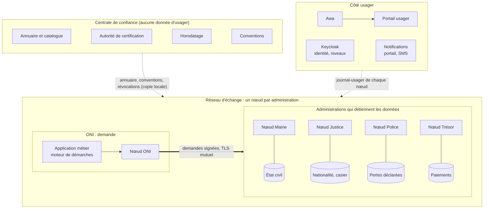
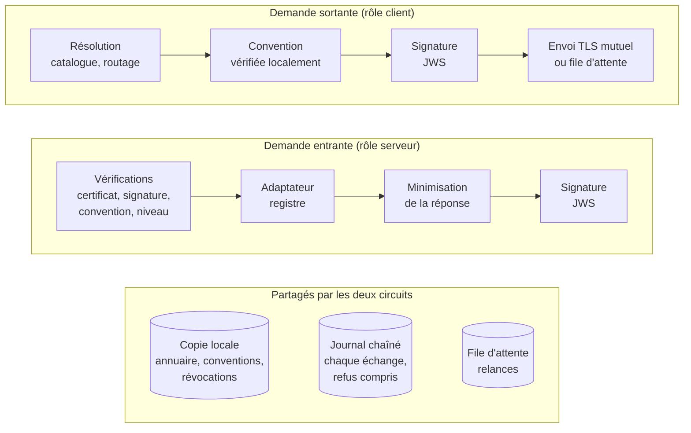
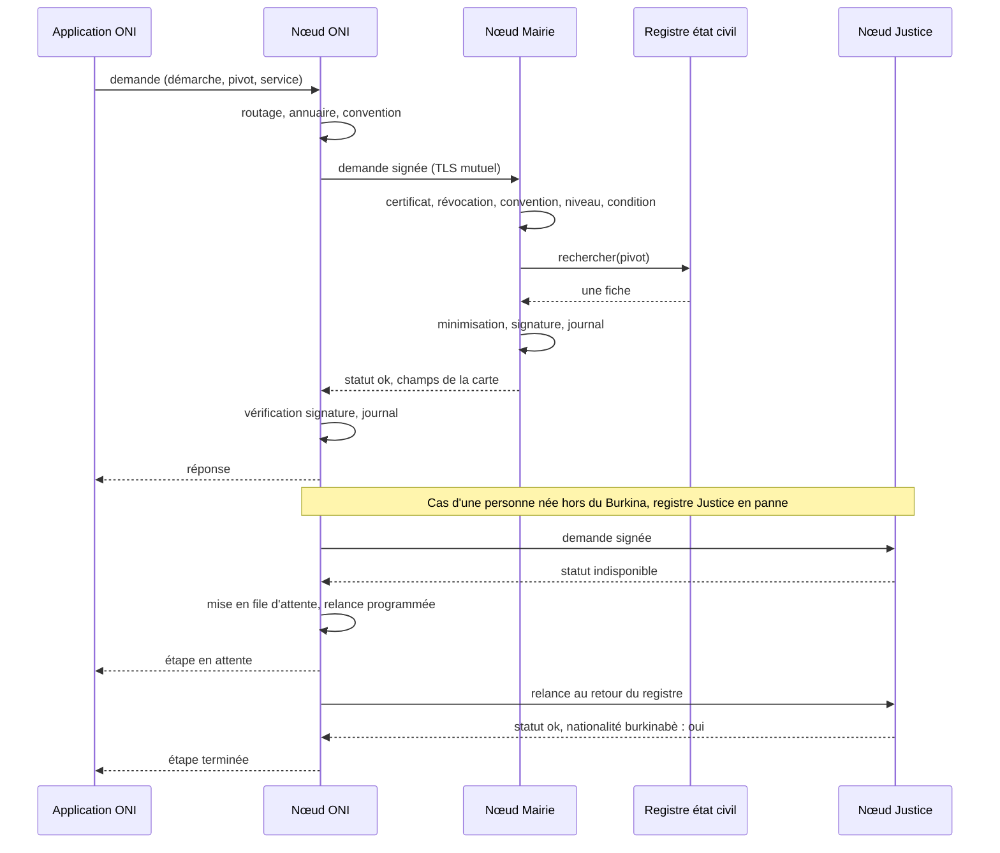

# Architecture du socle d'interopérabilité « Dites-le-nous une fois »

**Hackathon des universités 2026 · Finale · Sujet 02**

> Document technique de référence : description de l'architecture, détail de chaque composant, flux, formats, sécurité, résilience, outils et déploiement.
>
> Version de travail du 16 novembre 2026. Le nom du projet n'est pas encore arrêté ; ce document parle du « socle ».

---

## Sommaire

1. [Objet et principes](#1-objet-et-principes)
2. [Vue d'ensemble](#2-vue-densemble)
3. [Les composants en détail](#3-les-composants-en-détail)
4. [Les flux](#4-les-flux)
5. [Formats et fichiers de configuration](#5-formats-et-fichiers-de-configuration)
6. [Sécurité](#6-sécurité)
7. [Résilience](#7-résilience)
8. [Outils et technologies](#8-outils-et-technologies)
9. [Déploiement](#9-déploiement)
10. [Arborescence du dépôt](#10-arborescence-du-dépôt)
11. [Stratégie de test](#11-stratégie-de-test)
12. [Hors périmètre et limites](#12-hors-périmètre-et-limites)

---

## 1. Objet et principes

Le socle permet aux administrations d'obtenir directement auprès des registres officiels les informations nécessaires à une démarche, au lieu de demander des pièces à l'usager. Il garantit trois choses : la **minimisation** (ne transmettre que l'utile), la **transparence** (l'usager voit qui a consulté ses données) et la **résilience** (le système tient quand un registre tombe en panne).

Principes d'architecture :

1. **Les données restent à la source.** Aucune base centrale, aucune copie des registres, aucune mémoire cache des réponses.
2. **Données décentralisées, confiance centralisée.** Chaque administration a son nœud ; la Centrale de confiance gère seulement l'annuaire, les certificats, l'horodatage et les conventions.
3. **Le nœud qui détient la donnée décide.** Les règles sont publiées au centre mais appliquées par le nœud détenteur.
4. **Un seul programme de nœud**, déployé dans chaque administration avec une configuration différente.
5. **Le nœud est générique, la démarche est métier.** Le déroulé d'une démarche vit dans l'application de l'administration qui demande, pas dans le nœud.
6. **Jamais « oui » par défaut.** Panne, identité ambiguë ou introuvable : le système le dit, il n'invente pas.
7. **Tout est tracé**, y compris les refus, dans des journaux chaînés tenus par chaque nœud.
8. **Aucune cryptographie maison.** Uniquement des bibliothèques et outils standard.

---

## 2. Vue d'ensemble



| Couche | Composants | Rôle |
|---|---|---|
| **Confiance** | Centrale de confiance | Qui fait partie du réseau, avec quels droits |
| **Échange** | Nœuds, adaptateurs | Transport sécurisé, règles, minimisation, journal |
| **Métier** | Application métier et moteur de démarches | Quoi vérifier, dans quel ordre, pour quelle démarche |
| **Usager** | Portail, Keycloak, notifications | Identification, transparence, suivi |
| **Sources** | Registres | Données officielles, jamais copiées |

---

## 3. Les composants en détail

### 3.1 Nœud d'échange

**Rôle** : porte d'entrée et de sortie de chaque administration sur le réseau. Le même programme joue les deux rôles : il envoie les demandes de son administration (rôle client) et répond à celles des autres (rôle serveur).



**Modules**

| Module | Responsabilité |
|---|---|
| **Sortant** | Reçoit une demande de l'application métier ; trouve le fournisseur (catalogue, règle de routage) et son adresse (annuaire) ; vérifie qu'une convention l'autorise ; signe et envoie ; met en attente si le fournisseur est indisponible |
| **Entrant** | Reçoit une demande d'un autre nœud ; vérifie certificat, signature, révocation, convention, niveau de garantie, condition, consentement si requis |
| **Moteur de règles** | Évalue les conventions et leurs conditions à partir de la copie locale |
| **Adaptateur** | Interroge le registre (voir 3.2) |
| **Minimisation** | Construit la réponse à partir de la fiche trouvée, selon le service : réponse fermée (« majeur : oui ») ou champs strictement nécessaires |
| **Signature** | Signe les demandes et réponses sortantes, vérifie celles qui entrent |
| **Journal chaîné** | Enregistre chaque échange, refus compris, avec l'empreinte de l'entrée précédente |
| **File d'attente** | Conserve les demandes en attente pendant une panne et les relance |
| **Copie locale** | Annuaire, catalogue, conventions et liste de révocation, rafraîchis périodiquement depuis la Centrale |
| **API journal-usager et santé** | Fournit au portail les entrées concernant un usager ; expose l'état du nœud et de son registre |

**API exposées**

| Méthode | Chemin | Appelant | Usage |
|---|---|---|---|
| `POST` | `/v1/demandes` | Application métier de la même administration | Soumettre une demande sortante |
| `GET` | `/v1/demandes/{id}` | Application métier | Suivre une demande (statut, réponse) |
| `POST` | `/v1/services/{service}` | Autres nœuds (TLS mutuel) | Recevoir une demande entrante |
| `GET` | `/v1/journal-usager/{identifiant}` | Portail usager (TLS mutuel, jeton de l'usager) | Entrées du journal concernant cet usager |
| `GET` | `/v1/sante` | Centrale, supervision | État du nœud et de son registre |

**Données stockées** : journal, file d'attente, copie locale de la configuration réseau. Jamais de données de registre.

### 3.2 Adaptateurs

**Rôle** : relier un nœud à un registre existant sans le copier.

- **Interface commune** : `rechercher(criteres)` renvoie une liste de fiches normalisées ; `sante()` indique si le registre répond.
- **Types prévus** : API REST, base de données (lecture seule), fichier (pour les registres simulés).
- **Correspondance des champs** décrite en configuration (nom du champ dans le registre vers nom normalisé), pour brancher un registre du jury sans réécrire de code.
- **Délai d'attente court** : au-delà, l'adaptateur lève une erreur « indisponible ».
- **Jamais d'écriture** dans le registre.

### 3.3 Centrale de confiance

**Rôle** : gouvernance du réseau, sans jamais voir de données d'usager.

| Fonction | Détail |
|---|---|
| **Annuaire et catalogue** | Membres, adresses de leurs nœuds, services offerts, règles de routage |
| **Autorité de certification** | Signe les demandes de certificat des nœuds ; publie la liste de révocation |
| **Horodatage** | Horodate périodiquement la dernière empreinte du journal de chaque nœud |
| **Conventions** | Enregistre les conventions acceptées par les deux parties, valide leur base, les publie |
| **Supervision** | Interroge `/v1/sante` de chaque nœud ; affiche l'état du réseau |
| **Contestations** | Reçoit les contestations d'usagers et les transmet à l'administration concernée |
| **Révocation** | Exclut un membre en révoquant son certificat |

**API** : `GET /v1/configuration` (annuaire, catalogue, conventions, révocations, versionnés et signés), `POST /v1/adhesions`, `POST /v1/conventions`, `POST /v1/horodatage`, `POST /v1/contestations`.

### 3.4 Application métier et moteur de démarches

**Rôle** : le processus métier de l'administration qui demande, ici l'ONI.

- **Guichet agent** : ouverture et instruction des dossiers.
- **Moteur de démarches** : lit la définition de la démarche (étapes, conditions, ordre), envoie les demandes au nœud, fait avancer l'état du dossier selon les réponses.
- **Ouverture d'un dossier** : l'usager y est identifié ; son identifiant pivot et son niveau de garantie sont inscrits dans le dossier.
- **Stockage** : les dossiers et les réponses reçues, propres à l'administration.
- **Événements** : chaque changement d'état est publié vers le service de notifications.

### 3.5 Portail usager

**Rôle** : la fenêtre de l'usager sur ses données, sans rien stocker.

- Connexion via Keycloak.
- **Journal agrégé** : appelle `journal-usager` sur chaque nœud et fusionne les résultats ; si un nœud ne répond pas, affiche « journal de la Justice momentanément indisponible ».
- **Contestation** : bouton « Je ne reconnais pas cette consultation », envoyé à la Centrale.
- **Rectification** : lien vers l'administration source.
- **Autorisations** : pour les rares conventions fondées sur le consentement.
- **Suivi** des démarches et notifications.

### 3.6 Identité : Keycloak

- Comptes des usagers, des agents et des administrateurs ; second facteur.
- **Attributs de l'usager** : `identifiant_pivot`, `niveau_garantie` (1 à 3), transmis dans le jeton.
- **Rôles** : `usager`, `agent`, `admin-local`, `admin-centrale`.
- Page de connexion en français.

### 3.7 Notifications

- Reçoit les événements de changement d'état des dossiers.
- Canaux : portail, SMS (**simulé** pour le hackathon).
- Messages sobres : référence du dossier, jamais de donnée personnelle sensible.

### 3.8 Services simulés pour la démonstration

| Simulation | Pourquoi |
|---|---|
| **Trésor** (paiement) | Faso Arzeka n'est pas intégrable en 72 h ; le nœud Trésor simulé accepte des paiements de test et permet de montrer un paiement non reçu |
| **Police** (pertes déclarées) | Registre fictif |
| **Biométrie** | L'enrôlement et le dédoublonnage sont représentés par une étape manuelle de l'agent |
| **SMS** | Affichage dans une boîte d'envoi simulée |
| **Registres fictifs** | Développement avant de recevoir ceux du jury |

### 3.9 Point d'entrée : Caddy

- Seul point exposé : portail, guichet, console de la Centrale, Keycloak.
- Les nœuds communiquent entre eux en TLS mutuel sur le réseau interne.
- Les API d'administration ne sont jamais publiques.

---

## 4. Les flux

### 4.1 Résolution d'une demande (côté ONI)

Comment le nœud ONI sait à qui s'adresser pour vérifier les données d'Awa :

1. **Démarche** : Awa ouvre une demande de CNIB, motif « première demande ».
2. **Identification** : son identifiant pivot (`ACTE:OUAGA:2004:01234`) et son niveau de garantie sont inscrits dans le dossier.
3. **Étapes** : le moteur de démarches lit la définition « demande-cnib » : identité, nationalité si née hors du Burkina, perte si motif « perte », paiement.
4. **Service** : étape identité, donc `identite-pour-titre`.
5. **Routage** : la commune inscrite dans l'identifiant (OUAGA) désigne la Mairie de Ouagadougou.
6. **Annuaire** : adresse du nœud de cette mairie.
7. **Convention** : vérification dans la copie locale ; sans convention, aucun appel.
8. **Envoi** : demande signée, en TLS mutuel.
9. **Suite** : la réponse « née au Burkina : oui » saute l'étape nationalité ; la Justice n'est jamais interrogée.

### 4.2 Traitement d'une demande (côté fournisseur) et panne



**Vérifications du nœud détenteur, dans l'ordre** (tout échec est journalisé) :

1. certificat valide et non révoqué ;
2. signature de la demande valide ;
3. convention existante pour ce demandeur, ce service et cette démarche ;
4. niveau de garantie suffisant ;
5. condition de la convention remplie ;
6. consentement présent si la base l'exige ;
7. interrogation du registre et décision selon le nombre de fiches (aucune : `introuvable` ; une : `ok` ; plusieurs : `ambigu`) ;
8. minimisation, signature, journal.

### 4.3 Journal de l'usager

1. Awa se connecte au portail.
2. Le portail appelle `journal-usager` sur chaque nœud, avec l'identifiant pivot et le jeton d'Awa.
3. Chaque nœud renvoie les entrées la concernant (qui, quoi, quand, pourquoi, sur quelle base, statut).
4. Le portail fusionne et trie ; rien n'est stocké.
5. Awa peut contester une ligne ; la contestation part vers la Centrale.

### 4.4 Adhésion d'une nouvelle administration

1. Installation du nœud (`docker compose up -d`).
2. Génération locale de la paire de clés ; envoi d'une demande de certificat à la Centrale.
3. Validation par la Centrale, retour du certificat, publication dans l'annuaire.
4. Branchement du registre via l'adaptateur, test de connexion.
5. Déclaration des services offerts.
6. Conventions acceptées par les deux parties, validées et publiées par la Centrale.

### 4.5 Identification de l'usager

| Situation | Identification | Niveau |
|---|---|---|
| Première demande en ligne | Référence de l'acte, élément connu de l'usager, code SMS ; la Mairie confirme « correspond : oui » | 2 |
| Première demande au guichet | Référence de l'acte ou recherche par nom, date, lieu, parents ; confirmation de la Mairie | 2 |
| Renouvellement | Ancienne carte ou identifiant unique déjà liés aux empreintes | 3 |
| Avant fabrication | Enrôlement biométrique et dédoublonnage | 3 |

Protection contre l'usurpation : le niveau 2 ne permet pas la fabrication ; le dédoublonnage biométrique bloque une identité déjà liée à d'autres empreintes ; le journal permet à l'usager de repérer et contester une démarche qu'il n'a pas lancée.

---

## 5. Formats et fichiers de configuration

### 5.1 Définition d'une démarche (chez l'administration qui demande)

```yaml
demarche: demande-cnib
etapes:
  - id: identite
    service: identite-pour-titre
  - id: nationalite
    service: nationalite-burkinabe
    si: "identite.ne_au_burkina == false"
  - id: perte
    service: declaration-perte
    si: "motif == 'perte'"
  - id: paiement
    service: statut-paiement
    apres: [identite, nationalite, perte]
```

### 5.2 Catalogue des services (publié par la Centrale)

```yaml
services:
  identite-pour-titre:
    routage: commune-de-l-acte
    fournisseurs:
      - membre: BF/GOV/MAIRIE-OUAGA
        communes: [OUAGA]
        adresse: https://noeud-mairie-ouaga:8443
      - membre: BF/GOV/MAIRIE-BOBO
        communes: [BOBO]
        adresse: https://noeud-mairie-bobo:8443
  nationalite-burkinabe:
    fournisseurs:
      - membre: BF/GOV/JUSTICE
        adresse: https://noeud-justice:8443
```

### 5.3 Convention

```yaml
- demandeur: BF/GOV/ONI
  fournisseur: BF/GOV/MAIRIE-OUAGA
  service: identite-pour-titre
  demarche: demande-cnib
  base: loi                       # ou : consentement
  texte: "Textes relatifs à la CNIB"
  niveau_garantie_min: 2
  condition: null
```

### 5.4 Configuration d'un nœud

```yaml
membre: BF/GOV/MAIRIE-OUAGA
centrale: https://centrale:8443
certificat: /secrets/noeud.crt
cle_privee: /secrets/noeud.key
adaptateur:
  type: api-rest                  # ou : base-de-donnees, fichier
  url: http://registre-etat-civil:8000
  delai_max_ms: 2000
  champs:
    nom: NOM_FAMILLE
    prenoms: PRENOMS
    date_naissance: DATE_NAISS
services_offerts:
  - identite-pour-titre
  - majeur
```

### 5.5 Demande et réponse

```json
{
  "id_demande": "3f1c9a2e-7b41-4c0e-9d5a-1e2f3a4b5c6d",
  "demandeur": "BF/GOV/ONI",
  "fournisseur": "BF/GOV/MAIRIE-OUAGA",
  "service": "identite-pour-titre",
  "demarche": "demande-cnib",
  "usager": { "identifiant_pivot": "ACTE:OUAGA:2004:01234", "niveau_garantie": 2 },
  "base": { "type": "loi" },
  "horodatage": "2026-11-16T10:42:00Z"
}
```

```json
{
  "id_demande": "3f1c9a2e-7b41-4c0e-9d5a-1e2f3a4b5c6d",
  "statut": "ok",
  "donnees": { "nom": "…", "prenoms": "…", "date_naissance": "…", "lieu_naissance": "…", "sexe": "…", "ne_au_burkina": true },
  "emis_par": "BF/GOV/MAIRIE-OUAGA",
  "horodatage": "2026-11-16T10:42:01Z"
}
```

Demandes et réponses circulent signées au format JWS.

| Statut | Signification | Données transmises |
|---|---|---|
| `ok` | Une fiche trouvée, demande autorisée | La réponse minimale |
| `refuse` | Convention absente, niveau insuffisant, condition non remplie, consentement manquant | Aucune, avec le motif |
| `introuvable` | Aucune fiche | Aucune |
| `ambigu` | Plusieurs fiches | Aucune, jamais la liste des candidats |
| `indisponible` | Registre injoignable | Aucune |

### 5.6 Entrée de journal

```json
{
  "id_demande": "3f1c9a2e-…",
  "horodatage": "2026-11-16T10:42:01Z",
  "demandeur": "BF/GOV/ONI",
  "fournisseur": "BF/GOV/MAIRIE-OUAGA",
  "service": "identite-pour-titre",
  "demarche": "demande-cnib",
  "base": "loi : Textes relatifs à la CNIB",
  "usager": "ACTE:OUAGA:2004:01234",
  "statut": "ok",
  "empreinte_precedente": "9c1e…",
  "empreinte": "a47b…"
}
```

Aucune valeur de réponse dans le journal.

---

## 6. Sécurité

| Menace | Protection |
|---|---|
| Faux nœud se faisant passer pour une administration | Certificats délivrés par la Centrale, TLS mutuel, vérification de la liste de révocation |
| Demande modifiée en route | Signature JWS de chaque demande et réponse |
| Administration qui demande plus que nécessaire | Conventions vérifiées par le nœud détenteur, réponses minimisées, refus journalisés |
| Fuite par excès de réponse | Minimisation par service ; aucune liste de candidats en cas d'ambiguïté |
| Journal falsifié après coup | Chaînage par empreintes SHA-256, horodatage périodique par la Centrale |
| Usurpation d'identité de l'usager | Niveaux de garantie, biométrie avant fabrication, journal contestable par l'usager |
| Compromission de la Centrale | Elle ne voit aucune donnée ; les nœuds appliquent leurs propres règles |
| Clé privée d'un nœud volée | Révocation du certificat par la Centrale, propagée par la copie locale |
| Accès aux interfaces d'administration | Keycloak avec second facteur, rôles, aucune API d'administration publique |
| Copie massive de données | Aucune base centrale, aucune mémoire cache, adaptateurs en lecture seule |

**Gestion des clés** : chaque nœud génère sa paire de clés localement ; la clé privée ne quitte jamais l'administration. En production, elle serait conservée dans un module matériel de sécurité ; pour le hackathon, dans un fichier protégé du conteneur.

---

## 7. Résilience

| Mécanisme | Effet |
|---|---|
| **Délai d'attente court** sur chaque registre | Une panne est détectée vite, sans bloquer le reste |
| **Coupe-circuit** | Après plusieurs échecs, le nœud cesse d'appeler le registre pendant un temps, puis réessaie |
| **File d'attente persistante** | Les demandes en attente survivent à un redémarrage |
| **Relances espacées progressivement** | Pas de surcharge du registre à son retour |
| **Idempotence** par `id_demande` | Une relance ne produit jamais un double traitement ni une double entrée de journal |
| **Étapes indépendantes en parallèle** | Une étape en panne n'empêche pas les autres d'avancer |
| **Copie locale de la configuration réseau** | Les échanges continuent si la Centrale tombe |
| **Journal usager tolérant** | Si un nœud ne répond pas, le portail affiche le reste et signale l'absence |
| **Notifications fiables** | Événement enregistré avec le changement d'état, envoyé avec relances |
| **Pas de mémoire cache des réponses** | Une panne ne conduit jamais à servir une réponse périmée |

---

## 8. Outils et technologies

Licences à revérifier au moment du dépôt.

### 8.1 Code et services

| Outil | Rôle | Licence |
|---|---|---|
| Python 3.12 | Langage des nœuds, de la Centrale et des applications | PSF |
| FastAPI | API des nœuds et de la Centrale, documentation interactive | MIT |
| Uvicorn | Serveur d'application | BSD-3-Clause |
| Pydantic | Validation des demandes, réponses et configurations | MIT |
| HTTPX | Appels sortants entre nœuds (TLS mutuel) | BSD-3-Clause |
| SQLAlchemy | Accès aux bases | MIT |
| PostgreSQL | Journal, file d'attente, dossiers, configuration de la Centrale | Licence PostgreSQL |
| PyYAML | Lecture des démarches, conventions, configurations | MIT |
| cryptography | Clés, certificats, empreintes | Apache-2.0 ou BSD |
| PyJWT | Signatures JWS | MIT |
| OpenSSL ou step-ca | Autorité de certification de la Centrale | Apache-2.0 |
| Keycloak | Identité, second facteur, rôles, attributs | Apache-2.0 |
| Jinja2 | Gabarits des interfaces | BSD-3-Clause |
| HTMX | Interactions légères sans framework JavaScript | BSD |
| Caddy | Point d'entrée HTTPS | Apache-2.0 |
| Docker Compose | Déploiement en une commande | Apache-2.0 |

### 8.2 Tests, données et documentation

| Outil | Rôle | Licence |
|---|---|---|
| pytest | Tests unitaires, d'intégration et de conformité | MIT |
| respx | Simulation des appels HTTP dans les tests | BSD-3-Clause |
| Faker | Génération des registres fictifs | MIT |
| Mermaid | Schémas de la documentation | MIT |
| OpenAPI | Spécification des échanges | Apache-2.0 |
| JSON Schema | Schémas des conventions et du journal | Licence libre |

### 8.3 Pourquoi ces choix

- **Python et FastAPI** : rapides à écrire, documentation de l'API générée automatiquement (utile au jury pour tester une demande excessive), déjà maîtrisés depuis le sprint.
- **PostgreSQL pour la file d'attente** : évite d'ajouter un composant (Redis ou un courtier de messages) pour 72 h.
- **Gabarits côté serveur plutôt qu'une application React** : le sujet porte sur le back-end, la sécurité et l'architecture.
- **Keycloak** : réutilisé du sprint, gère nativement attributs, rôles et second facteur.
- **Outils standard pour la cryptographie** : aucune fonction de chiffrement écrite par l'équipe.

---

## 9. Déploiement

### 9.1 Services Docker Compose

| Service | Rôle |
|---|---|
| `caddy` | Point d'entrée |
| `keycloak`, `keycloak-db` | Identité |
| `centrale`, `centrale-db` | Centrale de confiance |
| `noeud-oni`, `noeud-mairie`, `noeud-justice`, `noeud-police`, `noeud-tresor` | Même image, configurations différentes |
| `noeud-*-db` | Journal et file d'attente de chaque nœud |
| `registre-etat-civil`, `registre-nationalite`, `registre-casier`, `registre-pertes`, `registre-paiements` | Registres simulés (remplacés par ceux du jury pour l'état civil, la nationalité et le casier) |
| `app` | Portail usager, guichet agent, console de la Centrale (trois espaces, une application) |
| `notifications` | Notifications et SMS simulés |

### 9.2 Extrait

```yaml
services:
  noeud-mairie:
    image: socle/noeud:latest
    environment:
      CONFIG: /config/noeud.yaml
    volumes:
      - ./config/mairie:/config:ro
      - ./secrets/mairie:/secrets:ro
    depends_on: [noeud-mairie-db]

  noeud-justice:
    image: socle/noeud:latest
    environment:
      CONFIG: /config/noeud.yaml
    volumes:
      - ./config/justice:/config:ro
      - ./secrets/justice:/secrets:ro
    depends_on: [noeud-justice-db]
```

Un nouveau nœud = un nouveau bloc de quelques lignes et un dossier de configuration.

### 9.3 Commandes

```bash
docker compose up -d                    # lancer tout le réseau
docker compose stop registre-casier     # simuler la panne d'un registre (épreuve)
docker compose start registre-casier    # retour du registre : les relances aboutissent
docker compose exec noeud-oni pytest conformite/   # tests de conformité
```

---

## 10. Arborescence du dépôt

```
socle-interop-bf/
├── LICENSE
├── README.md
├── docker-compose.yml
├── specs/
│   ├── echange.openapi.yaml
│   ├── convention.schema.json
│   ├── demarche.schema.json
│   ├── journal.schema.json
│   └── securite.md
├── regles/                     gouvernance, droits des usagers, minimisation, pannes
├── noeud/
│   ├── sortant/                résolution, routage, envoi
│   ├── entrant/                vérifications
│   ├── regles/                 moteur de conventions
│   ├── minimisation/
│   ├── signature/
│   ├── journal/
│   └── file_attente/
├── adaptateurs/                interface + API REST, base de données, fichier
├── centrale/                   annuaire, catalogue, AC, horodatage, conventions, supervision
├── app/
│   ├── usager/                 portail
│   ├── agent/                  guichet + moteur de démarches
│   └── centrale/               console
├── notifications/
├── conformite/                 tests que tout nœud doit réussir
├── config/                     configuration de chaque nœud de démonstration
└── demo/
    ├── registres/              registres fictifs et cas pièges
    ├── demarches/              demande-cnib.yaml, concours.yaml
    └── conventions/
```

---

## 11. Stratégie de test

| Niveau | Contenu |
|---|---|
| **Unitaires** | Moteur de règles, minimisation, routage, chaînage du journal, décision selon le nombre de fiches |
| **Conformité** | Refus hors convention ; refus de niveau insuffisant ; `ambigu` sans divulgation ; `indisponible` au lieu d'inventer ; journalisation de chaque échange ; signature de chaque réponse |
| **Intégration** | Démarche CNIB de bout en bout sur le réseau Docker |
| **Scénarios d'épreuves** | Minimisation, journal visible en quelques secondes, panne puis reprise, homonymes, panne de la Centrale, branchement d'une nouvelle administration |

Cas pièges dans les registres fictifs : mineur, majeur dans quelques jours, homonymes nés le même jour, absent d'un registre, casier avec condamnation, décédé, nationalité acquise, orthographes différentes, né à l'étranger, carte déclarée perdue.

---

## 12. Hors périmètre et limites

| Élément | Traitement dans le prototype | En production |
|---|---|---|
| Paiement | Nœud Trésor simulé | Raccordement à Faso Arzeka |
| Biométrie | Étape manuelle de l'agent | Système biométrique de l'ONI |
| SMS | Boîte d'envoi simulée | Passerelle d'un opérateur |
| Clés privées | Fichiers protégés | Modules matériels de sécurité |
| Registres | Simulés ou fournis par le jury | Registres réels, avec leurs problèmes de qualité et de numérisation |
| Échelle | Quelques nœuds sur une machine | Un nœud par administration, centaines de mairies |

Limites assumées :

- Le principe supprime les pièces papier, pas le passage physique pour la biométrie.
- Un registre incomplet (acte jamais numérisé) impose un repli exceptionnel vers une pièce vérifiée manuellement.
- Établir l'identité la première fois reste le point le plus délicat ; le socle s'appuie sur la biométrie de l'ONI et, à terme, sur l'identifiant unique électronique.
- Le journal contient des métadonnées sensibles (qui a consulté qui) : son accès est réservé à l'usager concerné et à l'administration qui l'a produit.
