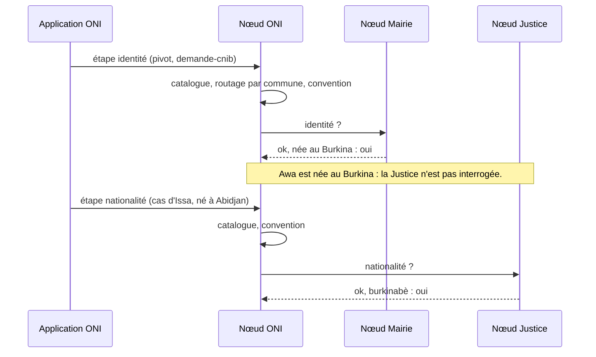
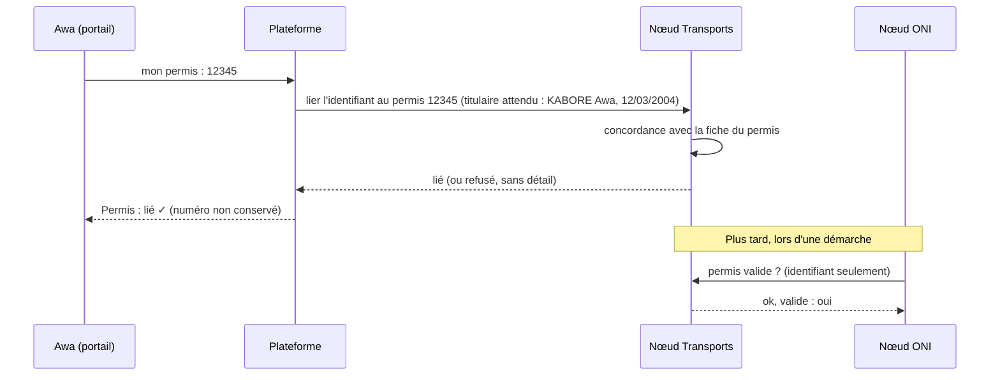

# Trouver les données d'un usager chez une autre administration

Comment le nœud ONI, qui instruit la CNIB d'Awa, sait que sa nationalité se vérifie auprès de la Justice, et comment il obtient la réponse. Et ce qu'Awa doit fournir, et quand.

Sources : [architecture-socle.md](architecture-socle.md) (§4.1, §4.2, §4.5, §5.2, §5.3) et [DITES-LE-NOUS-UNE-FOIS.md](DITES-LE-NOUS-UNE-FOIS.md) (§7, §10, §20, §21). Le document de référence de l'équipe reste [architecture.md](architecture.md).

## En bref

- Awa prouve **une seule fois qui elle est**. Elle obtient un **identifiant pivot**, la référence de son acte de naissance : `ACTE:OUAGA:2004:01234`.
- Elle ne fournit **aucune autre information** : ni nationalité, ni casier, ni document.
- À chaque démarche, le **nœud ONI trouve lui-même** quelle administration détient l'information. Il s'appuie sur le catalogue des services et l'annuaire, publiés par la Centrale.
- Il pose une **question ciblée** (« burkinabè : oui ou non ? ») avec l'identifiant pivot. Il ne récupère jamais le certificat de nationalité.

Les sections 1 à 6 décrivent l'architecture prévue. Les sections 7 à 9 sont des **propositions à discuter** :

- un identifiant opaque à la place de la référence de l'acte (§7) ;
- un lien entre pièce et identifiant établi par le détenteur de la pièce (§8) ;
- la déclaration des références de ses pièces par l'usager, à l'inscription (§9).

## 1. Établir l'identité, une seule fois

L'identité est établie à l'inscription sur le portail ou au premier passage au guichet.

| Situation | Comment | Niveau de garantie |
|---|---|---|
| Première demande en ligne | Référence de l'acte, élément connu de l'usager, code SMS. La Mairie confirme « correspond : oui ». | 2 |
| Première demande au guichet | Référence de l'acte ou recherche par nom, date, lieu et parents. Confirmation de la Mairie. | 2 |
| Renouvellement | Ancienne carte ou identifiant déjà lié aux empreintes | 3 |
| Avant fabrication de la carte | Enrôlement biométrique et dédoublonnage | 3 |

Le résultat est enregistré dans Keycloak : attributs `identifiant_pivot` et `niveau_garantie`. Ils figurent dans le jeton de connexion (voir [infrastructure/keycloak/README.md](../infrastructure/keycloak/README.md)). L'usager ne peut pas les modifier : seul un administrateur le peut.

## 2. Trouver le détenteur, à chaque démarche

Le citoyen est toujours à l'origine : sans dossier ouvert, aucune requête ne part. Quand Awa demande sa CNIB :

1. **Dossier** : son identifiant pivot et son niveau de garantie, lus dans le jeton, sont inscrits dans le dossier.
2. **Étapes** : le moteur de démarches lit la définition `demande-cnib`. Elle contient l'identité, la nationalité *si l'usager est né hors du Burkina*, la perte *si le motif est une perte*, puis le paiement.
3. **Catalogue** : pour chaque étape, le nœud cherche quel membre fournit le service. Le catalogue est publié par la Centrale, et chaque nœud en garde une copie locale :

   ```yaml
   services:
     identite-pour-titre:
       routage: commune-de-l-acte          # OUAGA -> Mairie de Ouagadougou
       fournisseurs:
         - { membre: BF/GOV/MAIRIE-OUAGA, communes: [OUAGA], adresse: https://noeud-mairie-ouaga:8443 }
         - { membre: BF/GOV/MAIRIE-BOBO,  communes: [BOBO],  adresse: https://noeud-mairie-bobo:8443 }
     nationalite-burkinabe:
       fournisseurs:
         - { membre: BF/GOV/JUSTICE, adresse: https://noeud-justice:8443 }
   ```

4. **Convention** : le nœud vérifie, dans sa copie locale, qu'une convention autorise cet échange. Sans convention, aucun appel ne part.

   ```yaml
   - demandeur: BF/GOV/ONI
     fournisseur: BF/GOV/JUSTICE
     service: nationalite-burkinabe
     demarche: demande-cnib
     base: loi                 # ou : consentement
     niveau_garantie_min: 2
   ```

5. **Envoi** : une demande signée, en TLS mutuel, ne contient que le nécessaire : `{pivot_id, procedure}`.



Pour Awa, née à Ouagadougou, la réponse de l'état civil suffit et la Justice **n'est jamais interrogée**. Elle l'est pour Issa SAWADOGO, né à Abidjan.

## 3. Ce que vérifie le détenteur

Le nœud Justice traite la demande dans cet ordre. Tout échec est journalisé.

1. Certificat du demandeur valide et non révoqué.
2. Signature de la demande valide.
3. Convention existante pour ce demandeur, ce service et cette démarche.
4. Niveau de garantie suffisant.
5. Condition de la convention remplie.
6. Consentement présent, si la base de la convention l'exige.
7. Recherche de la personne : aucune fiche donne `not_found`, une seule donne `ok`, plusieurs donnent `ambiguous`.
8. Réponse minimisée, signée et journalisée : `burkinabe: true`, sans le mode d'acquisition ni le document.

Awa peut ensuite voir cette consultation dans son journal sur le portail.

## 4. Aucun document n'est copié

C'est le principe du sujet. La plateforme ne transporte pas le certificat de nationalité, ni aucun autre PDF. Elle interroge le registre et ne transmet que la réponse à la question posée. Le document d'origine n'est jamais manipulé ni copié ([guide](DITES-LE-NOUS-UNE-FOIS.md), §10).

## 5. La même chose avec X-Road

| Rôle | Socle (architecture-socle.md) | X-Road | Dans notre code aujourd'hui |
|---|---|---|---|
| Qui est membre, à quelle adresse | Annuaire de la Centrale | Configuration globale du serveur central | `interoperability/connectors/routing.yaml` |
| Adresser un service | Nom du service dans le catalogue | `BF/GOV/JUSTICE/REGISTRES` + code de service | `connector.query(organisation, service, payload)` |
| Qui a le droit d'appeler | Conventions | Droits d'accès sur le Security Server du fournisseur | Non contrôlé |
| Démarche, niveau de garantie | Conventions vérifiées par le nœud détenteur | Hors X-Road : à contrôler par le fournisseur | Non contrôlé |

Les droits d'accès X-Road disent seulement *quel sous-système peut appeler quel service*. La démarche et le niveau de garantie restent à vérifier par l'adaptateur ou le registre du fournisseur.

Correspondance des noms de services : `identite-pour-titre` correspond à `identity`, et `nationalite-burkinabe` à `nationality` dans nos registres simulés.

## 6. Hypothèse à confirmer : un identifiant commun

Toute cette architecture **suppose** que chaque registre retrouve la personne à partir de l'identifiant pivot ([guide](DITES-LE-NOUS-UNE-FOIS.md), §20, hypothèse 2). Nos registres simulés sont tous indexés ainsi.

En réalité, la Justice a probablement ses propres numéros. Deux solutions sont prévues :

- **Table de correspondance** entre l'identifiant pivot et l'identifiant propre au registre, tenue par le détenteur.
- **Recherche par critères** : nom, prénoms, date de naissance, lieu facultatif. Le contrat `registry-request` l'accepte déjà, et les registres simulés répondent `ambiguous` en cas d'homonymes, sans rien divulguer (voir les deux Moussa TRAORE).

Qui fait ce rapprochement, et comment il s'assure qu'il s'agit de la bonne personne : voir §8.

**À demander au jury** ([guide](DITES-LE-NOUS-UNE-FOIS.md), §21, question 2) : les registres fournis partagent-ils un identifiant commun ?

## 7. Limites de l'identifiant pivot actuel

> Proposition à discuter. Changer la forme de l'identifiant modifie le contrat `registry-request` : décision collective.

L'identifiant pivot n'est imprimé sur aucune pièce. Il sert de clé commune entre les registres.

Choisir l'acte de naissance se défend : c'est la racine de l'identité. La CNIB, le passeport ou le certificat de nationalité sont délivrés sur présentation de l'acte. Mais sous sa forme actuelle, `ACTE:<COMMUNE>:<AAAA>:<NNNNN>`, l'identifiant a des limites :

| Limite | Conséquence |
|---|---|
| Tout le monde n'a pas d'acte classique : beaucoup d'adultes ont un jugement supplétif | Référence d'un autre type, hors du format prévu |
| Personnes nées à l'étranger | Acte tenu ailleurs. Nos données de test masquent ce cas : Issa SAWADOGO, né à Abidjan, a un identifiant `ACTE:OUAGA:…`. |
| Doublons : personne déclarée deux fois | Deux identifiants pour une même personne |
| Registres anciens non numérisés, formats différents selon les communes | Référence introuvable ou mal saisie |
| **L'identifiant a un sens** | `ACTE:OUAGA:2004:01234` révèle l'année et la commune de naissance. Toute administration qui tient le dossier sait qu'Awa a environ 22 ans : la réponse minimisée `adult: true` perd son intérêt. |
| Le même identifiant dans tous les registres | Croisement de fichiers facilité en cas de fuite |

**Proposition : séparer l'identifiant et les clés de rapprochement.**

| Élément | Rôle |
|---|---|
| **Identifiant opaque**, aléatoire et sans signification (ex. `BF-7K2M9Q4X`) | Désigne la personne dans les échanges. Attribué à la première identification, il ne révèle rien. |
| **Clés de rapprochement** : référence d'acte ou de jugement supplétif, numéro de CNIB, de permis, nom + date + lieu de naissance | Servent à retrouver la personne dans un registre, la première fois seulement |
| **Correspondance tenue par chaque registre** | Voir §8 |
| **Cible à terme** | Identifiant unique électronique de l'ONI, lié à la biométrie |
| **Évolution possible** | Un identifiant différent par secteur, dérivé du premier (modèle autrichien), pour empêcher le croisement direct de fichiers |

Ce changement touche :

- le realm Keycloak ;
- les données des registres simulés ;
- le motif de `pivot_id` dans le contrat ;
- le filtre des notifications, qui refuse les messages contenant `ACTE:…` ;
- la documentation.

Le routage « commune de l'acte → mairie » (§2) ne pourra plus lire l'identifiant. Il s'appuiera sur la clé de rapprochement, c'est-à-dire la référence de l'acte.

## 8. Qui relie une pièce à l'identifiant, et comment

Il y a deux vérifications distinctes :

1. **La personne correspond-elle à l'identifiant ?** Cette vérification est faite une fois, à l'identification (§1).
2. **La fiche du registre (casier, permis, certificat) correspond-elle à l'identifiant ?** C'est le rapprochement. Il est fait par le détenteur de la fiche.

### Le détenteur, et lui seul

| Acteur | Peut-il faire le lien ? |
|---|---|
| Citoyen | Non : il pourrait réclamer la fiche d'un autre, par exemple un casier vierge. Il peut en revanche fournir un indice (un numéro de pièce), que le détenteur vérifie (§9). |
| Administration qui demande | Non : elle n'a pas accès aux fiches du détenteur, et verrait les candidats possibles, ce qui contredit la minimisation. |
| Table centrale | Non : ce serait le fichier le plus sensible du pays. Le guide interdit toute base centrale des données des citoyens. |
| **Détenteur du registre** | **Oui** : il est responsable de ses données, connaît ses fiches et garde le lien chez lui. |

### Quand le lien se fait

1. **À la délivrance d'une nouvelle pièce.** C'est le cas le plus fiable. L'usager est déjà identifié quand on lui délivre son permis ou son casier, donc le lien est enregistré à la source. Avec le temps, ce cas devient la règle.
2. **À la première interrogation, pour les pièces anciennes.** Le détenteur cherche par nom, prénoms, date et lieu de naissance, et noms des parents. De préférence, il obtient ces critères lui-même auprès de l'état civil plutôt que du demandeur : les Transports n'ont pas besoin de connaître la date de naissance pour demander un casier.
3. **Par un rattrapage en masse, en option.** Le registre compare ses fiches à l'état civil. Les liens sûrs sont créés, les cas douteux sont soumis à un agent.

### Comment le détenteur sait que c'est la bonne personne

| Preuve | Confiance | Décision |
|---|---|---|
| La fiche contient déjà une clé forte : référence de l'acte (souvent copiée dans le dossier de nationalité) ou numéro de pièce | Certaine | Lien automatique |
| Une seule fiche correspond, et tous les critères concordent, parents compris (accents et variantes d'orthographe normalisés) | Probable | Lien, marqué « probable » |
| Plusieurs fiches correspondent (les deux Moussa TRAORE), ou les critères ne concordent qu'en partie | Insuffisante | `ambiguous` : aucun lien, aucune donnée transmise |
| Un agent vérifie au guichet, la personne étant présente avec sa pièce physique | Certaine | L'agent confirme le lien |

Trois règles complètent ce tableau :

- **Un faux lien est pire que pas de lien.** Attribuer à Awa le casier d'un autre serait grave. Dans le doute, la réponse est `ambiguous` ou `not_found`, jamais une supposition. C'est la même règle que « jamais de oui par défaut » dans les registres.
- **Le niveau de confiance du lien est enregistré** (certain ou probable), comme le niveau de garantie de l'identité. Une convention peut exiger un lien certain pour une question sensible, comme le casier.
- **L'usager contrôle après coup.** Dans son journal, Awa voit « Justice : casier consulté ». Elle peut contester par « ce n'est pas moi », et le lien est revu ([architecture-socle.md](architecture-socle.md), §4.3).

## 9. Proposition : déclarer les références de ses pièces à l'inscription

**L'idée :** à l'inscription, Awa enregistre les références de ses pièces. Lors d'une démarche, le nœud demandeur utilise la référence utile pour interroger le détenteur.

**Ses atouts :**

- Chaque registre est interrogé avec sa propre clé : il n'a pas besoin de connaître l'identifiant pivot. C'est utile si les registres du jury n'ont pas d'identifiant commun (§6).
- Le risque d'homonymie disparaît pour les pièces dont la référence est connue : le détenteur **vérifie** une fiche au lieu d'en **chercher** une.
- C'est simple à montrer en démo.

**Ses limites, si on l'applique telle quelle :**

1. **Une référence ne prouve pas que la pièce appartient à l'usager.** Awa pourrait saisir le numéro de permis d'une amie, ou se tromper d'un chiffre. Le détenteur doit toujours vérifier que sa fiche correspond à l'identité d'Awa.
2. **La liste de toutes les références d'Awa devient un fichier central sensible.** Elle relie toutes ses pièces entre elles. Et si le nœud demandeur y a accès, les Transports voient son numéro de certificat de nationalité alors qu'ils n'en ont pas besoin.
3. **Les références changent.** Un permis renouvelé ou une nouvelle CNIB ont un nouveau numéro, et la liste saisie à l'inscription devient fausse.
4. **Certaines pièces n'ont pas de référence.** Le casier judiciaire n'a pas de numéro permanent, et une déclaration de perte n'existe pas encore à l'inscription. Beaucoup d'usagers, notamment les personnes illettrées, ne connaissent pas leurs numéros.

### Variante recommandée : la référence sert une fois, le lien reste chez le détenteur

1. À l'inscription, Awa indique son numéro de permis, si elle le connaît.
2. La plateforme le transmet **aux Transports seulement**, avec l'identité attendue : « lier cet identifiant au permis 12345 ; titulaire attendu : KABORE Awa, née le 12/03/2004 ».
3. Les Transports vérifient la concordance. Si elle est bonne, ils enregistrent le lien chez eux. Sinon, ils refusent sans rien révéler.
4. Le portail affiche « Permis : lié ✓ », sans conserver le numéro.
5. Lors d'une démarche, le nœud demandeur n'envoie que l'identifiant. Chaque détenteur sait déjà à quelle fiche il correspond.



Selon la pièce, le lien se fait ainsi :

| Pièce | Comment elle est liée |
|---|---|
| Acte de naissance | C'est la base de l'identification elle-même (§1) |
| CNIB, permis, passeport | Référence déclarée par l'usager et vérifiée par le détenteur, ou lien enregistré à la délivrance |
| Certificat de nationalité | Idem. Mais la question « burkinabè ? » peut se trancher sans certificat (née au Burkina de parent burkinabè). |
| Casier judiciaire | Pas de référence : recherche par identité chez la Justice, `ambiguous` en cas de doute (§8) |
| Déclaration de perte | Liée au moment où elle est faite, l'usager étant identifié |

**Version simple acceptable pour le hackathon**, à deux conditions : le détenteur vérifie **toujours** la concordance avec l'identité, et le nœud demandeur ne reçoit que la référence dont il a besoin, jamais la liste complète.

**Ce que la proposition demande :**

- **Contrat `registry-request`** : une référence de pièce dans `subject` (par exemple `document: {type, number}`), et un service de liaison chez chaque détenteur.
- **Portail** : une étape « mes pièces » dans le parcours d'inscription (Personne 1).
- **Orchestration** : l'envoi des demandes de liaison et le suivi de leur état (Personne 2).
- **Registres** : l'enregistrement du lien et de son niveau de confiance (Personne 3).

## 10. État de l'implémentation

| Élément | État | Responsable |
|---|---|---|
| Identifiant pivot et niveau de garantie dans le jeton | Fait (Keycloak) | Personne 3 |
| Registres interrogeables par identifiant pivot ou par critères, `ambiguous` en cas d'homonymes | Fait (5 registres simulés) | Personne 3 |
| Adressage d'une organisation : direct ou X-Road | Fait (connecteurs) | Personne 3 |
| Catalogue des services : « nationalité » donne l'organisation et le code de service | À faire. Aujourd'hui, le backend doit connaître `BF/GOV/JUSTICE/REGISTRES`. | Personne 3 |
| Routage par commune de l'acte (`ACTE:BOBO:…` vers la mairie de Bobo) | À faire (une seule mairie simulée) | Personne 3 |
| Définitions des démarches et étapes conditionnelles | À faire | Personne 2 |
| Conventions, contrôle du niveau de garantie | À faire. Le contrat `registry-request` ne transporte pas encore le niveau de garantie. | Personnes 2 et 3 |
| Journal visible par l'usager | À faire | Personnes 1 et 2 |
| Identifiant opaque à la place de `ACTE:…` | Proposition (§7), à décider | Collectif |
| Lien enregistré par le détenteur après une recherche par critères, avec son niveau de confiance | À faire. Les registres simulés supposent le lien déjà fait. | Personne 3 |
| Contestation d'une consultation par l'usager | À faire | Personnes 1 et 2 |
| Déclaration des références à l'inscription et service de liaison | Proposition (§9), à décider | Personnes 1, 2 et 3 |
